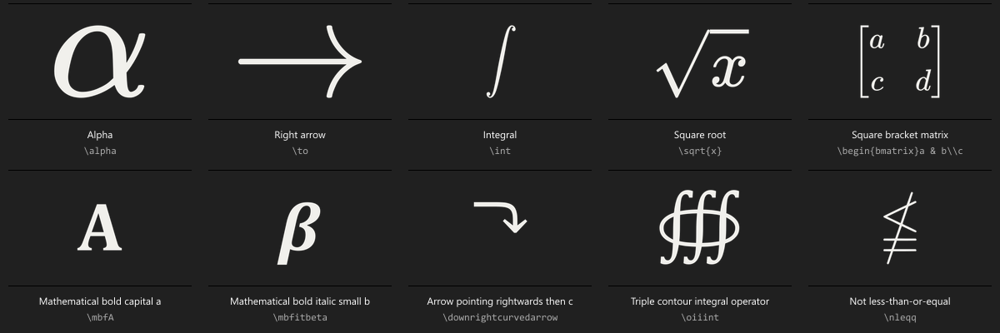

# LaTeX Palette

An offline LaTeX picker for Raycast on Windows and macOS. Search in everyday English,
browse symbols like emoji, and press **Enter** to paste the selected entry's LaTeX
into your previous application.

**3,100 entries · English search · Enter to paste · Fully offline**

## Install

You need [Raycast](https://www.raycast.com/) on Windows or macOS and
[Node.js 22.14 or newer](https://nodejs.org/en/download). Open Raycast before installing.

1. [Download the latest source ZIP](https://github.com/leanderriefel/latex-palette/releases/latest/download/latex-palette-source.zip) and extract it.
2. Open a terminal in the extracted folder, the one containing `package.json`.
3. Run:

   ```sh
   npm ci
   npm run install-extension
   ```

4. Open Raycast and run **Search LaTeX**. Try `arrow`, select a symbol, and press **Enter**.

Installation builds and registers the extension locally, then exits. You can close the
terminal; no development watcher or server needs to keep running.

If the command does not appear, run **Import Extension** in Raycast, select the extracted
folder, and run `npm run install-extension` again. Raycast's developer import commands
may ask you to sign in. Keep the source folder if you want to update or customize it.

Prefer Git? Use this instead of downloading the ZIP:

```sh
git clone https://github.com/leanderriefel/latex-palette.git
cd latex-palette
npm ci
npm run install-extension
```

This is a GitHub distribution. Raycast Store submission is a separate step.



## Use it

Open Raycast and run **Search LaTeX**. Try:

- `arrow`, `arrow pointing right`, `double arrow`, `harpoon`
- `less than or equal`, `not equal`, `upside down A`, `backwards E`
- `integral`, `partial derivative`, `matrix`, `square root`, `bold`
- `chemical formula`, `units`, `bra ket`, `commutative diagram`, `circuit`
- `code block`, `table`, `numbered list`, `page margin`, `beamer`
- A command such as `\alpha`, `\Gamma`, or `\rightarrow`, or a symbol such as `→`.

Matching entries appear first, followed by nearby concepts and alternatives. Search
supports aliases, partial words, plurals, and small spelling mistakes such as `intergal`.
Exact command search respects uppercase and lowercase, so `\Gamma` ranks separately
from `\gamma`. Every matching result remains available; there is no arbitrary result cap.

Use arrow keys to select a card and **Enter** to paste. **Ctrl+C** on Windows or
**Cmd+C** on macOS copies the LaTeX instead. Open **Actions** for optional details,
favorites, package imports, math delimiters, and the list view.

| Action           | Windows      | macOS       |
| ---------------- | ------------ | ----------- |
| Paste LaTeX      | Enter        | Return      |
| Copy LaTeX       | Ctrl+C       | Cmd+C       |
| Show details     | Ctrl+D       | Cmd+D       |
| Toggle favorite  | Ctrl+Shift+F | Cmd+Shift+F |
| Switch grid/list | Ctrl+Shift+L | Cmd+Shift+L |

The filter dropdown selects a category, favorites, or recent picks. Favorites and
up to 30 recently used entries are saved locally. Recent history can be disabled in
the extension preferences. The default view is the symbol grid.

## Coverage and insertion

The catalog combines **745 curated entries** with a supplemental symbol collection
generated from the base/AMS mappings and the maintained unicode-math symbol table.
Duplicates of curated commands are removed when the catalog loads. Together they
provide over **3,000 symbols and snippets**, including common and specialist variants.

Coverage includes Greek letters, operators, relations, arrows, sets and logic,
calculus, linear algebra, probability, accents, fonts, brackets, environments,
document structure, text, tables, references, and packages. Practical templates cover
AMS math, mathtools, physics, braket, mhchem, chemfig, siunitx, TikZ, tikz-cd,
Circuitikz, PGFPlots, booktabs, listings, minted, biblatex, natbib, cleveref,
tcolorbox, Beamer, geometry, and more.

- Symbol entries paste the symbol's command: **Integral** inserts `\int`.
  Separate entries such as **Integral template** insert complete examples.
- Commands needing arguments include editable examples: **Square root** inserts `\sqrt{x}`.
  Templates use ordinary text; they do not attempt to move the destination editor's cursor.
- Raw LaTeX is pasted by default. Preferences can wrap math entries in `$…$` or `\[ … \]`.
  Complete environments, package imports, and text templates keep their own formatting.
- Details show required `\usepackage` lines. **Copy Package Imports** copies these separately.
  Imports belong in the preamble of your destination document.
- The extended unicode-math entries require **LuaLaTeX or XeLaTeX**, the `unicode-math`
  package, and a supporting math font. Common base and AMS alternatives rank first.
  The extension inserts source code; the destination editor must support the selected package.
- File, citation, diagram, and document templates contain example values to replace.
  Some commands depend on a document class or additional toolchain; read their details.
  For example, minted requires its highlighting setup, and Beamer frames belong in a Beamer document.

All search data and light/dark previews are bundled. There are no API keys, AI calls,
search requests, or rendering services at runtime. Math symbols have rendered previews;
document-only templates use labeled cards.

## Update

For a Git checkout, run these commands in the source folder:

```sh
git pull --ff-only
npm ci
npm run install-extension
```

If you installed from a ZIP, download a newer release and repeat the installation
steps in its extracted folder. The extension name stays the same, preserving favorites
and recent picks in Raycast's local storage.

## Develop

Install Raycast and Node.js 22.14 or newer, then run these commands in this directory:

```sh
npm ci
npm run dev
```

Development mode reloads the command when you edit its sources. Run **Search LaTeX**
in Raycast to see changes.

Stop the development watcher with **Ctrl+C** after making changes. The compiled
local extension remains available in Raycast. Assign a Raycast alias or hotkey to
**Search LaTeX** if desired.

## Maintain it

```sh
npm run typecheck
npm run lint
npm run build
```

Edit `src/data/catalog.json` to add descriptions and templates. To regenerate the
supplemental symbol catalog and themed PNG previews:

```sh
npm run symbols
npm run assets
```

Previews are already included, so ordinary installation does not need regeneration.
The asset generator caches unchanged entries. Run `npm run build` after a catalog
change to check the build in `dist/`. Run `npm run install-extension` to install the
updated command, or use the development watcher while editing.

The source manifest uses `leand` as its local author identifier. Before publishing
to the Raycast Store, replace it with your actual Raycast Store username, then run
`npm run lint:store`. Store author validation is separate from local source linting.
This project has not been published to the Store.

See `src/data/README.md` for catalog conventions and primary package references,
and `THIRD_PARTY_NOTICES.md` for bundled source data and license notices.
